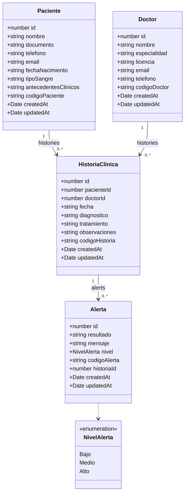
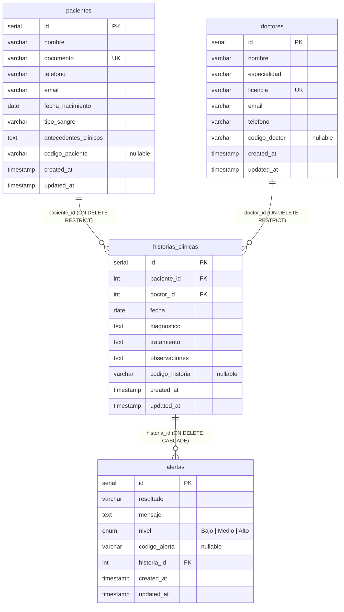

# LabHealt

## Diagnóstico y datos clínicos

**API de resultados de laboratorio:** pacientes, doctores, sus historias clínicas y las
alertas de anormalidad que salen de un resultado fuera de rango.

NestJS + TypeORM + PostgreSQL. El frontend que la consume está en
[LabHealthFrontend](https://github.com/JuanAcostaACE/LabHealthFrontend).

## Entidades

| Entidad | Tabla | Relaciones |
|---|---|---|
| `Paciente` | `pacientes` | 1..* historias clínicas |
| `Doctor` | `doctores` | 1..* historias clínicas |
| `HistoriaClinica` | `historias_clinicas` | *..1 paciente, *..1 doctor, 1..* alertas |
| `Alerta` | `alertas` | *..1 historia clínica (`ON DELETE CASCADE`) |

Borrar una historia borra sus alertas.

## Endpoints

Base: `http://localhost:3000`

### Pacientes

| Método | Ruta | Notas |
|---|---|---|
| GET | `/pacientes` | array de pacientes |
| GET | `/pacientes/:id` | 404 si no existe |
| GET | `/pacientes/:id/historias` | **`{ data, count }`** |
| GET | `/pacientes/search/:nombre` | `{ result: email }` |
| POST | `/pacientes` | `CreatePacienteDto` |
| PUT | `/pacientes/:id` | parcial (`PartialType`) |
| DELETE | `/pacientes/:id` | |

### Doctores

| Método | Ruta | Notas |
|---|---|---|
| GET | `/doctores` | array de doctores |
| GET | `/doctores/:id` | 404 si no existe |
| GET | `/doctores/:id/historias` | array de historias |
| GET | `/doctores/search/:nombre` | `{ result: email }` |
| POST | `/doctores` | `CreateDoctorDto` |
| PUT | `/doctores/:id` | parcial |
| DELETE | `/doctores/:id` | |

### Historias clínicas

| Método | Ruta | Notas |
|---|---|---|
| GET | `/historias-clinicas` | trae `paciente` y `doctor` completos |
| GET | `/historias-clinicas/:id` | igual, con relaciones |
| GET | `/historias-clinicas/:id/alertas` | array de alertas |
| GET | `/historias-clinicas/search/:diagnostico` | `{ result: tratamiento }` |
| POST | `/historias-clinicas` | valida que el paciente y el doctor existan (400 si no) |
| PUT | `/historias-clinicas/:id` | parcial |
| DELETE | `/historias-clinicas/:id` | borra también sus alertas |

### Alertas de anormalidad

| Método | Ruta | Notas |
|---|---|---|
| GET | `/alerta-anormalidad` | array de alertas |
| GET | `/alerta-anormalidad/:id` | |
| POST | `/alerta-anormalidad` | exige `historiaId`; 400 si la historia no existe |
| PUT | `/alerta-anormalidad/:id` | parcial |
| DELETE | `/alerta-anormalidad/:id` | |

## Payloads

```jsonc
// POST /pacientes
{ "nombre": "Ana", "documento": "123", "telefono": "3001112222",
  "email": "ana@test.com", "fechaNacimiento": "1995-04-12",
  "tipoSangre": "O+", "antecedentesClinicos": "ninguno" }

// POST /doctores
{ "nombre": "Dr House", "especialidad": "General", "licencia": "LIC-1",
  "email": "house@test.com", "telefono": "3001112222" }

// POST /historias-clinicas
{ "pacienteId": 1, "doctorId": 1, "fecha": "2026-11-12",
  "diagnostico": "Anemia", "tratamiento": "Hierro", "observaciones": "control" }

// POST /alerta-anormalidad   (nivel: Bajo | Medio | Alto)
{ "resultado": "Hemoglobina 7", "mensaje": "Valor bajo", "nivel": "Alto", "historiaId": 1 }
```

## Reglas de los campos

| Entidad | Campo | Regla |
|---|---|---|
| Paciente | `nombre` | letras, espacios, apóstrofos, puntos y guiones; 3 a 255 |
| Paciente | `documento` | solo dígitos, 5 a 20, único |
| Paciente | `telefono` | solo dígitos, 7 a 15 |
| Paciente | `email` | email válido, máx. 255 |
| Paciente | `fechaNacimiento` | fecha `YYYY-MM-DD`, no futura |
| Paciente | `tipoSangre` | `A+`, `A-`, `B+`, `B-`, `AB+`, `AB-`, `O+` u `O-` |
| Paciente | `antecedentesClinicos` | texto, 3 a 1000 |
| Doctor | `nombre` | letras, espacios, apóstrofos, puntos y guiones; 3 a 255 |
| Doctor | `especialidad` | mismas reglas que `nombre` |
| Doctor | `licencia` | letras, números y guiones; 3 a 50, único |
| Doctor | `email` | email válido, máx. 255 |
| Doctor | `telefono` | solo dígitos, 7 a 15 |
| Historia clínica | `pacienteId`, `doctorId` | entero positivo, debe existir |
| Historia clínica | `fecha` | fecha `YYYY-MM-DD`, no futura |
| Historia clínica | `diagnostico` | texto, 3 a 500 |
| Historia clínica | `tratamiento` | texto, 3 a 500 |
| Historia clínica | `observaciones` | texto, 3 a 1000 |
| Alerta | `resultado` | texto, 3 a 255 |
| Alerta | `mensaje` | texto, 3 a 500 |
| Alerta | `nivel` | `Bajo`, `Medio` o `Alto` |
| Alerta | `historiaId` | entero positivo, debe existir |

Todos los campos de creación son obligatorios. Las mismas reglas aplican a los `PUT`,
porque los DTOs de actualización extienden `PartialType`.

## Validación y errores

`ValidationPipe` global. Los errores salen como `{ statusCode, message, error }`, donde
`message` es un `string` o un `string[]`:

```json
{ "statusCode": 400, "message": ["nivel must be one of the following values: Bajo, Medio, Alto"], "error": "Bad Request" }
```

- **400** · payload inválido, o `pacienteId` / `doctorId` / `historiaId` que no existen
- **404** · el recurso pedido por `:id` no existe

Los DTOs de actualización extienden `PartialType`: un `PUT` puede traer un solo campo.

## Instalación

```bash
npm install
```

## Ejecución

```bash
# desarrollo
npm run start

# modo watch
npm run start:dev

# producción
npm run start:prod
```

CORS está habilitado (`app.enableCors()`), de modo que un frontend servido en otro
puerto —como el de Vite en `http://localhost:5173`— puede consumir la API directamente.

## Variables de entorno

```bash
cp .env.example .env   # opcional, hay valores por defecto
```

| Variable | Default |
|---|---|
| `PORT` | `3000` |
| `POSTGRES_HOST` | `localhost` |
| `POSTGRES_PORT` | `5432` |
| `POSTGRES_DB` | `labhealth_db` |
| `POSTGRES_USER` | `labhealth_user` |
| `POSTGRES_PASSWORD` | `labhealth_password` |

## Pruebas

```bash
# unitarias
npm run test

# e2e
npm run test:e2e

# cobertura
npm run test:cov
```

También está la colección de Postman (`LabHealt.postman_collection.json`) en la raíz.

## Diagrama de entidades



## Diagrama de la base de datos



El esquema lo crea TypeORM con `synchronize`, a partir de las entidades de `src/`.

## Docker

```bash
docker compose up --build
```

- API: http://localhost:3000
- pgAdmin: http://localhost:5050
- PostgreSQL: localhost:5432

## Integrantes

- Juan David Acosta Urbano
- Juan Esteban Cuaran Santanader
- Joseph Herrera
